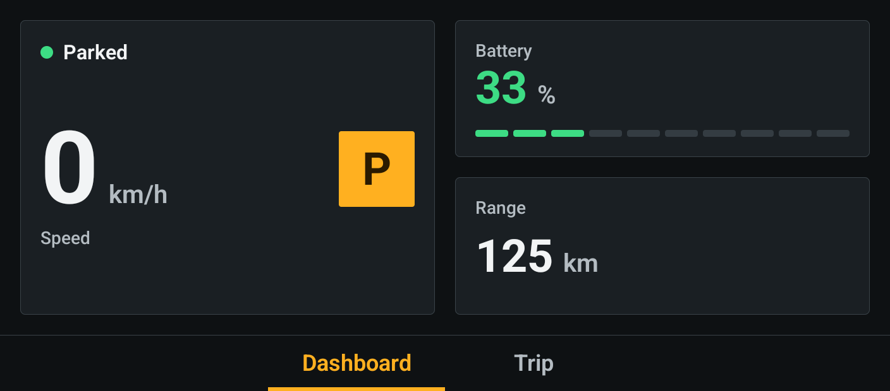
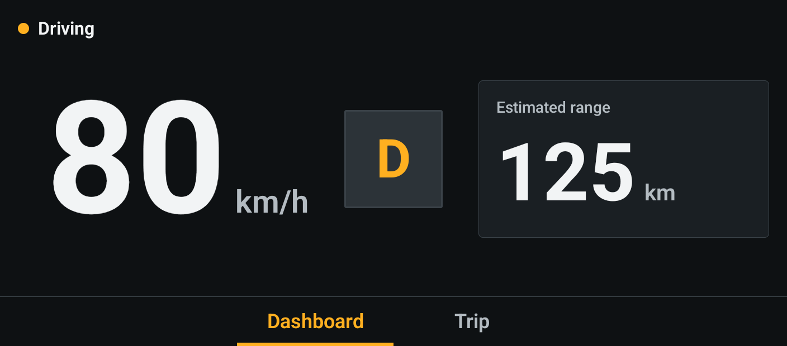
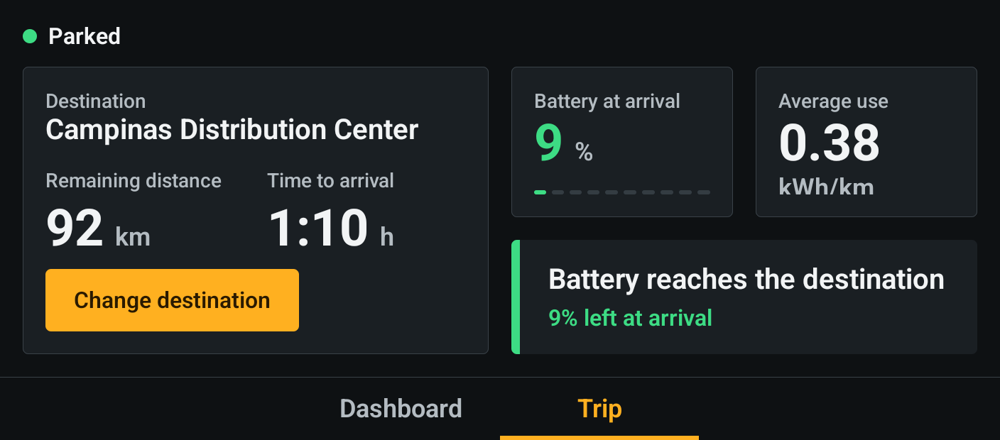
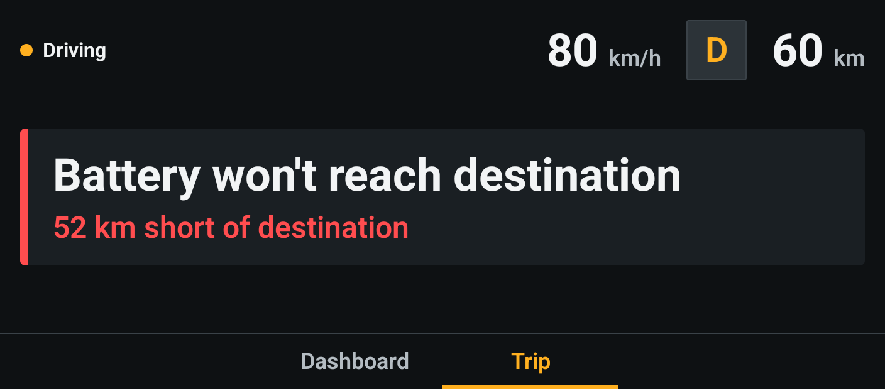

# Truck Cockpit

Driver dashboard for electric trucks on **Android Automotive OS**. It reads speed, gear, battery and range from the vehicle through the Car API. When the truck moves, it switches to a reduced driving layout, then back to the full layout when parked.

Portfolio project: no backend, no accounts, no network. Everything runs on the head unit.

| | Parked | Driving |
|---|---|---|
| **Dashboard** |  |  |
| **Trip** |  |  |

## Features

- **Dashboard:** speed, gear, battery level and estimated range, each with a clear "not available" state when the property or permission is missing.
- **Trip:** pick a destination while parked; the app integrates speed into distance, shows energy use per km after the first km, and warns when the battery won't reach the destination.
- **Driving mode:** follows `CarUxRestrictionsManager`. While moving, each screen shows fewer elements with larger text and touch targets (at least 76 dp). Until the restrictions are known, the app assumes driving.

## Architecture

MVI + Clean Architecture in a multi-module Gradle build, with convention plugins in `build-logic/`.

```
:app → :feature:dashboard, :feature:trip, :core:ui, :core:data, :core:domain
:feature:* → :core:domain, :core:ui
:core:data → :core:domain
:core:ui   → :core:domain
:baselineprofile → :app
```

| Module | Contents |
|---|---|
| `:app` | Activity, navigation, Hilt wiring, manifest (automotive feature, permissions, `distractionOptimized`) |
| `:core:domain` | Pure Kotlin: models, `VehicleDataSource` and `TripRepository` interfaces, use cases; fakes in `testFixtures` |
| `:core:data` | `CarVehicleDataSource` (`CarPropertyManager`, `CarUxRestrictionsManager`), trip tracking, simulated destinations |
| `:core:ui` | Theme and shared composables (gauges, big buttons, alert banner, tab bar) |
| `:feature:dashboard`, `:feature:trip` | Screen, ViewModel and State/Intent/Effect contract |
| `:baselineprofile` | Baseline Profile generator (Dashboard → Trip → Dashboard) |

Screens and use cases never touch the Car API: everything goes through `VehicleDataSource`, so ViewModel tests run on the JVM with a fake.

## Stack

Kotlin, Jetpack Compose, Material 3, Hilt, Coroutines + Flow, `android.car` (`CarPropertyManager`, `CarUxRestrictionsManager`). Tests: JUnit, Turbine, Roborazzi. Quality: LeakCanary (debug), Baseline Profile. CI: GitHub Actions.

## Running it

You need an AAOS emulator: the **Automotive (1408p landscape)** device with an **"Android Automotive with Google APIs"** x86_64 image, API 33 or later (tested on API 35). Google Play images can't `adb root`, which the scripts below need.

```bash
./gradlew installDebug
scripts/simulate-trip.sh          # parked -> cruise -> climb -> stop, by injecting VHAL events
```

On the Trip tab, pick "Campinas Distribution Center" while parked. During the cruise the average energy use shows up. The climb then triggers the "Battery won't reach destination" warning.

## Quality gates

```bash
./gradlew assembleDebug test verifyRoborazziDebug lint   # what CI runs, plus compiling :baselineprofile
```

- **Snapshot tests:** Roborazzi, every screen in parked and driving mode, at the emulator's display size.
- **LeakCanary** in debug builds.
- **Baseline Profile** checked in under `app/src/release/generated/baselineProfiles/`.

## Startup

Cold start, time to initial display (TTID), with and without the Baseline Profile, and with and without R8 (code shrinking, optimization and resource shrinking). The release build ships with both.

| Build | Compilation | Median | P90 | Launches |
|---|---|---|---|---|
| R8 off | None (`verify`, no AOT code) | 850.0 ms | 899.2 ms | 15 |
| R8 off | Baseline Profile (`speed-profile`) | 629.0 ms | 758.4 ms | 15 |
| **R8 on** | None (`verify`, no AOT code) | 545.0 ms | 623.4 ms | 15 |
| **R8 on** | **Baseline Profile (`speed-profile`), as released** | **454.0 ms** | **488.8 ms** | 15 |

- **Baseline Profile, R8 on:** median −16.7%, P90 −21.6%. Faster in all 3 rounds (round medians 520 / 581 / 544 ms without, 438 / 457 / 456 ms with).
- **R8, with the profile:** median −27.8% (629 → 454 ms). R8 also shrinks the APK from 27.2 MB to 1.9 MB.
- **Both, against neither:** median −46.6% (850 → 454 ms).

Measured on 2026-11-24 on the `Automotive_1408p_landscape` emulator (Android Automotive with Google APIs, x86_64, API 35), with a `benchmarkRelease` build (release-like, no LeakCanary). Host: AMD Ryzen 5 5500, 16 GB RAM, Windows 11. Within each run, the two compilation modes alternated in rounds of 5 launches, so emulator drift affected both. The R8 off and on runs came one after the other in the same emulator session (R8 on first), not interleaved, so some host drift is in that comparison: the R8-off medians rose across its rounds (748 / 858 / 874 ms without the profile). Even so, every R8-off round was slower than every R8-on round in the same mode.

Emulator numbers are only useful for comparing before and after within one run: across sessions on this host, the median of the same build and mode ranged from about 0.5 s to 2.0 s, depending on host load. A real head unit (ARM, slower storage) would give different absolute numbers.

**Why a script instead of Macrobenchmark.** AAOS runs apps as the driver (user 10), while user 0 is the headless system user. Jetpack Benchmark assumes user 0. `:app:generateBaselineProfile` runs the generator but pulls its output from user 0's storage ("No baseline profile rules were generated"). Macrobenchmark fails with `SHELL-ACCESS-DENIED`, and even with that suppressed it can't write its Perfetto trace or install the profile (ProfileInstaller: `RESULT_NOT_WRITABLE`). [`scripts/baseline-profile.sh`](scripts/baseline-profile.sh) does the same work through the shell:

```bash
scripts/baseline-profile.sh generate       # runs BaselineProfileGenerator as the driver, pulls the profile
scripts/baseline-profile.sh benchmark 30   # cold launches with and without the profile
```
